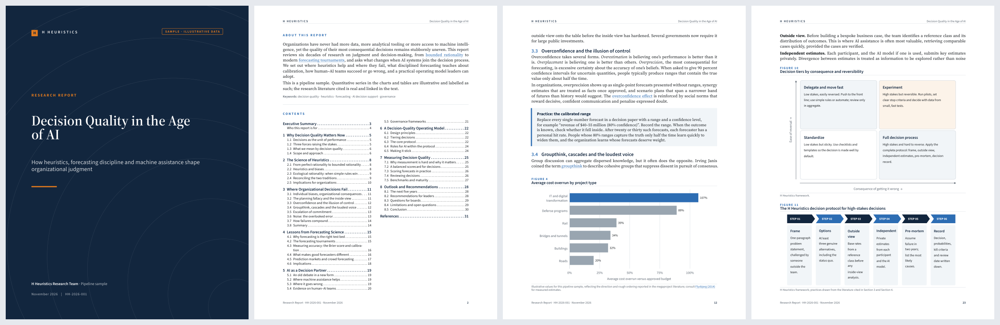
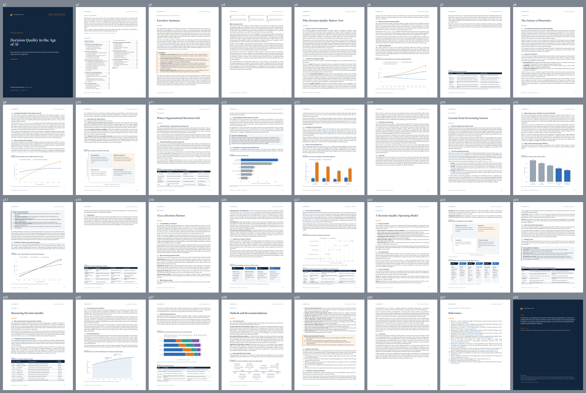

# H Heuristics Research Report Pipeline

Markdown in, publication-ready research reports out: a **typeset PDF** and an **editable Word
document** with the same content, numbering, figures, tables and live hyperlinks, plus an
automated quality gate built so AI agents (Gemini in Google Antigravity) can produce reports at
volume without a designer.



**Sample output:** [`output/sample-decision-quality/sample-decision-quality.pdf`](output/sample-decision-quality/sample-decision-quality.pdf)
· [`.docx`](output/sample-decision-quality/sample-decision-quality.docx)
(32 pages, 14 figures, 7 tables, 64 in-text links; passes the gate with no warnings).

## What you get

| Requirement | How the pipeline meets it |
|---|---|
| 30–50 pages | QA fails outside the range and states roughly how many words to add or cut |
| Each section on a new page; subsections not | `#` headings open a new page with a section opener; `##` flow on |
| Pages full of content | Figures and short tables **float** to the top or bottom of the page so text fills the gaps; QA measures how full every page is and flags half-empty pages with a precise fix ("add ~340 words or trim ~140") |
| In-text hyperlinks | Markdown links become live links in PDF and Word; QA requires 25+, checks each one live and verifies DOIs against the DOI registry |
| Visuals 5–6" wide | 14 chart/diagram types rendered in house style at 6.0" (clamped to 5.0–6.0"); vector in the PDF, 300 dpi in Word |
| Publication ready | Cover, abstract and two-column contents page, running headers and footers, numbered figures and tables, cross-references, PDF bookmarks and metadata, branded back cover with citation and disclaimer, justified and hyphenated text, widow control |
| PDF / Word | PDF typeset with [Typst](https://typst.app); DOCX generated with native Word styles, numbering, a TOC field and full-bleed covers |
| Mass production | One command per report, a topic queue, agent instructions, Antigravity workflows and a CI gate |

## Quick start

```bash
git clone https://github.com/Hunterhghs/H-Heuristics-Research-Papers-pipeline.git
cd H-Heuristics-Research-Papers-pipeline
./setup.sh                       # Python 3.10+; creates .venv, installs everything (Typst included)
./hh make sample-decision-quality  # build PDF + DOCX, run QA with live link checks
```

Create a report:

```bash
./hh new ai-in-insurance-2027 --title "AI in Commercial Insurance"
# write reports/ai-in-insurance-2027/report.md and sections/*.md
./hh make ai-in-insurance-2027
open output/ai-in-insurance-2027/ai-in-insurance-2027.pdf
```

No system packages are needed. [LibreOffice](https://www.libreoffice.org/) is optional and only
used for `--docx-preview` (renders the Word file to PDF so you can check it).

## Using it with Google Antigravity (Gemini)

The repo is set up for agent-driven production:

- [`AGENTS.md`](AGENTS.md) – the operating manual: research, outline, draft, build, fix QA, review, commit.
- [`GEMINI.md`](GEMINI.md) – short entry point with the non-negotiables.
- [`.agent/rules/hh-report-standards.md`](.agent/rules/hh-report-standards.md) – always-on rule (sourcing, scope, definition of done).
- [`.agent/workflows/`](.agent/workflows) – slash commands:
  - **`/new-report`** – one report end to end
  - **`/batch-reports`** – work through `queue/topics.csv`, one finished report per row
  - **`/fix-qa`** – bring an existing report to a clean pass

Typical use: fill [`queue/topics.csv`](queue/topics.csv) with topics (`status=todo`), open the
folder in Antigravity and run `/batch-reports`. Each report is researched, written, built,
checked against the gate, visually reviewed via `build/<slug>/preview.png` and committed before
the next one starts.

The gate is what makes mass production safe: an agent cannot declare a report done while it is
too short or too long, has half-empty pages, broken or placeholder links, missing sources,
or leftover template text.

## Commands

| Command | Purpose |
|---|---|
| `./hh new <slug> --title "…"` | scaffold `reports/<slug>/` from the template |
| `./hh lint <slug>` | validate Markdown only (seconds) |
| `./hh build <slug>` | render PDF + DOCX to `output/<slug>/` |
| `./hh qa <slug>` | build + quality gate |
| `./hh make <slug>` | build + quality gate + live link check (definition of done) |
| `./hh batch --all [--check-links]` | rebuild and check every report |
| `./hh queue` | show the topic queue |

Flags: `--pdf-only`, `--docx-only`, `--docx-preview`, `--no-preview`, `--strict`.
`make test` runs the regression fixture; `make sample` rebuilds the sample.

## Writing a report

Reports are Markdown with a little extra syntax for charts, callouts and stat rows. See
[`docs/AUTHORING_GUIDE.md`](docs/AUTHORING_GUIDE.md) for everything, and
[`docs/STYLE_GUIDE.md`](docs/STYLE_GUIDE.md) for house voice and sourcing rules.

````markdown
# Market Landscape {#landscape}

## Adoption is concentrated in large firms

Adoption among firms with 250+ employees reached 41% in 2025, according to
[Eurostat](https://ec.europa.eu/eurostat/...). See @fig:adoption.

```chart
type: line
id: adoption
caption: "Large firms adopt at twice the rate of small ones"
source: "Source: [Eurostat](https://ec.europa.eu/eurostat/...), 2025."
categories: [2021, 2022, 2023, 2024, 2025]
suffix: "%"
series:
  - {name: Large firms, values: [18, 24, 30, 35, 41]}
  - {name: Small firms, values: [7, 9, 12, 16, 20]}
```

::: callout What this means
Short, shaded box for implications or a worked example.
:::
````

Chart types: `line`, `area`, `bar`, `barh`, `stacked_bar`, `stacked_barh`, `dumbbell`,
`scatter`, `donut`, `waterfall`, `heatmap`, and diagrams `process`, `matrix`, `timeline`.
All use a colour palette validated for colour-blind separation, one y-axis only, and a legend
only when there are two or more series. Your own PNG/JPG/SVG images work too.



## How it works

```
reports/<slug>/report.md + sections/*.md
        │  parse (markdown-it): numbering, captions, cross-references, validation
        ▼
   document model ──► charts (matplotlib, house style) ──► SVG + 300-dpi PNG
        │                                   │
        ├──► Typst source ──► PDF  ◄────────┘ (vector)
        └──► python-docx  ──► DOCX ◄─────────── (PNG)
                    │
                    ▼
     QA (PyMuPDF): pages, per-page fill, section tails, gaps, links, counts → qa.json + preview.png
```

```
brand/brand.yaml        colours, fonts, layout, QA thresholds, About/disclaimer text
brand/fonts/            Source Serif 4 + Source Sans 3 (SIL Open Font License)
hhreport/               the pipeline (parse, charts, render_typst, render_docx, qa, cli)
hhreport/templates/     Typst page design
reports/_template/      scaffold copied by `./hh new`
reports/_features/      regression fixture: every element and chart type
reports/<slug>/         one folder per report (source)
output/<slug>/          finished PDF + DOCX (committed)
build/<slug>/           intermediates, qa.json, preview.png (git-ignored)
queue/topics.csv        production backlog for batch runs
```

## Customizing the brand

Edit [`brand/brand.yaml`](brand/brand.yaml): organization name, wordmark, About text, disclaimer,
website/email, colours, fonts, paper size (`us-letter` or `a4`), margins, body size and every QA
threshold. All renderers read it; no code changes needed. The PDF uses the bundled fonts in
`brand/fonts/`; the DOCX uses Cambria and Calibri so it looks identical on any machine with
Microsoft Office (change `docx_body` / `docx_heading` if you prefer).

## Notes on the two formats

- **PDF is the canonical, page-exact output.** QA measures the PDF.
- **DOCX is the editable twin.** Word paginates on its own, so page breaks differ slightly and
  figures sit inline rather than floating. Word asks to update fields on first open; accept to
  fill the contents page numbers.
