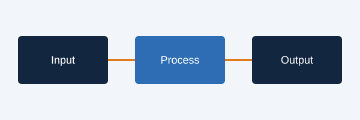

<!-- HTML comments like this one are ignored by the renderer. -->

# Executive Summary

Body text with **bold**, *italic*, `inline code`, an [inline hyperlink](https://www.nist.gov/),
"smart quotes", en–dashes -- and em---dashes. Cross-references resolve automatically:
see @fig:line, @tbl:simple and @sec:charts.

::: keyfindings
1. **Finding one.** Key findings box with a numbered list.
2. **Finding two.** Uses the accent fill.
:::

::: stats
- 42% | of something, with a [link](https://example.com)
- $3.1T | market size by 2030
- 7x | faster decisions
- 0.18 | mean Brier score
:::

::: callout A callout with a title
Callouts hold paragraphs and lists.

- bullet one
- bullet two
:::

> A pull quote with an attribution line that starts with an em dash.
>
> — Attributed Person, Role

# Chart Gallery {#charts}

## Time series

```chart
type: line
id: line
caption: "Line chart with end labels and a projected segment"
source: "Source: made-up data."
categories: [2020, 2021, 2022, 2023, 2024, 2025, 2026, 2027]
suffix: "%"
y_label: "Share of firms"
series:
  - name: Actual then projected
    values: [5, 9, 14, 21, 29, 38, 46, 53]
    projected_from: 2025
  - name: Comparison
    values: [3, 5, 8, 11, 15, 19, 24, 28]
annotations:
  - {x: 2023, y: 21, text: "Annotation with a leader line"}
```

```chart
type: area
caption: "Area chart, single series (no legend box)"
source: "Source: made-up data."
categories: [Q1, Q2, Q3, Q4, Q5, Q6]
prefix: "$"
suffix: "m"
values: [12, 15, 14, 19, 23, 27]
```

## Comparisons

```chart
type: bar
caption: "Column chart with a highlighted category"
source: "Source: made-up data."
categories: [North America, Europe, Asia-Pacific, Latin America, Middle East & Africa]
highlight: [Asia-Pacific]
suffix: "%"
values: [24, 19, 31, 12, 9]
```

```chart
type: barh
caption: "Horizontal bars for long category names"
source: "Source: made-up data."
categories: ["A long category name that wraps", "Second category", "Third", "Fourth category here"]
values: [82, 64, 51, 37]
suffix: "%"
```

```chart
type: stacked_bar
caption: "Stacked columns with totals"
source: "Source: made-up data."
categories: [2023, 2024, 2025, 2026]
series:
  - {name: Software, values: [10, 14, 19, 25]}
  - {name: Services, values: [8, 9, 11, 12]}
  - {name: Hardware, values: [5, 5, 4, 4]}
```

```chart
type: stacked_barh
caption: "Stacked horizontal bars"
source: "Source: made-up data."
categories: [Team A, Team B, Team C]
suffix: "%"
totals: false
series:
  - {name: Agree, values: [60, 45, 30]}
  - {name: Neutral, values: [25, 30, 30]}
  - {name: Disagree, values: [15, 25, 40]}
```

```chart
type: dumbbell
caption: "Dumbbell: before versus after"
source: "Source: made-up data."
categories: [Metric one, Metric two, Metric three]
suffix: "%"
series:
  - {name: "2024", values: [40, 55, 62]}
  - {name: "2026", values: [58, 61, 49]}
```

## Relationships and composition

```chart
type: scatter
caption: "Scatter with labels, groups and a trend line"
source: "Source: made-up data."
x_label: "Investment ($m)"
y_label: "Return (%)"
y_suffix: "%"
trend: true
points:
  - {label: Alpha, x: 10, y: 12, group: Leaders}
  - {label: Beta, x: 22, y: 18, group: Leaders}
  - {label: Gamma, x: 35, y: 21, group: Leaders}
  - {label: Delta, x: 15, y: 7, group: Followers}
  - {label: Epsilon, x: 28, y: 11, group: Followers}
```

```chart
type: donut
caption: "Donut with centre label"
source: "Source: made-up data."
categories: [Equity, Debt, Grants, Other]
values: [52, 28, 13, 7]
center_text: "$4.2bn"
center_label: "total raised"
```

```chart
type: waterfall
caption: "Waterfall bridge from start to end value"
source: "Source: made-up data."
categories: [2025 revenue, Price, Volume, Mix, FX, 2026 revenue]
prefix: "$"
suffix: "m"
values: [100, 8, 12, -5, -3, 112]
```

```chart
type: heatmap
caption: "Heatmap on the sequential ramp"
source: "Source: made-up data."
rows: [Finance, Health, Retail, Energy]
columns: [Adoption, Spend, Talent, Governance]
suffix: "%"
values:
  - [72, 65, 40, 58]
  - [48, 52, 35, 61]
  - [66, 70, 44, 39]
  - [41, 38, 29, 55]
```

## Diagrams

```chart
type: process
caption: "Process diagram (2-6 steps)"
source: "Source: H Heuristics."
steps:
  - {title: Frame, text: "Define the decision and the alternatives"}
  - {title: Gather, text: "Collect evidence from the best available sources"}
  - {title: Weigh, text: "Score options against explicit criteria"}
  - {title: Decide, text: "Commit and record the rationale"}
```

```chart
type: matrix
caption: "Two-by-two matrix with plotted points"
source: "Source: H Heuristics."
x_label: "Feasibility →"
y_label: "Impact →"
quadrants:
  - {title: "Big bets", text: "High impact, hard to do."}
  - {title: "Quick wins", text: "High impact, easy to do."}
  - {title: "Avoid", text: "Low impact, hard to do."}
  - {title: "Fill-ins", text: "Low impact, easy to do."}
points:
  - {label: "Initiative A", x: 0.75, y: 0.8}
  - {label: "Initiative B", x: 0.3, y: 0.65}
```

```chart
type: timeline
caption: "Timeline (3-9 events)"
source: "Source: H Heuristics."
events:
  - {date: "2024", title: "Launch", text: "First version released"}
  - {date: "2025", title: "Scale", text: "Expanded to three markets"}
  - {date: "2026", title: "Regulation", text: "New rules take effect", highlight: true}
  - {date: "2027", title: "Maturity", text: "Market consolidates"}
```

{width=5.5in}

Source: H Heuristics illustration.

# Tables

Table: A simple table with alignment {#simple}

| Item | 2024 | 2025 | Change |
|:-----|-----:|-----:|-------:|
| Compute | 10.2 | 12.5 | +22% |
| Labour | 30.1 | 28.0 | −7% |
| Total | 40.3 | 40.5 | +0.5% |

Source: Made-up data. Notes and sources can carry [links](https://example.com).

Paragraph after the table. A long table (more than 14 rows) flows across pages with a repeating header:

Table: A long table that breaks across pages

| Rank | Country | Value | Notes |
|---:|:--|--:|:--|
| 1 | Alpha | 98 | First |
| 2 | Bravo | 95 | |
| 3 | Charlie | 91 | |
| 4 | Delta | 88 | |
| 5 | Echo | 84 | |
| 6 | Foxtrot | 80 | |
| 7 | Golf | 77 | |
| 8 | Hotel | 73 | |
| 9 | India | 70 | |
| 10 | Juliet | 66 | |
| 11 | Kilo | 61 | |
| 12 | Lima | 57 | |
| 13 | Mike | 52 | |
| 14 | November | 48 | |
| 15 | Oscar | 45 | |
| 16 | Papa | 41 | Last |

1. Ordered list item one.
2. Ordered list item two, with a nested list:
   - nested bullet
   - another
3. Item three.

# References

1. National Institute of Standards and Technology. [AI Risk Management Framework](https://www.nist.gov/itl/ai-risk-management-framework).
